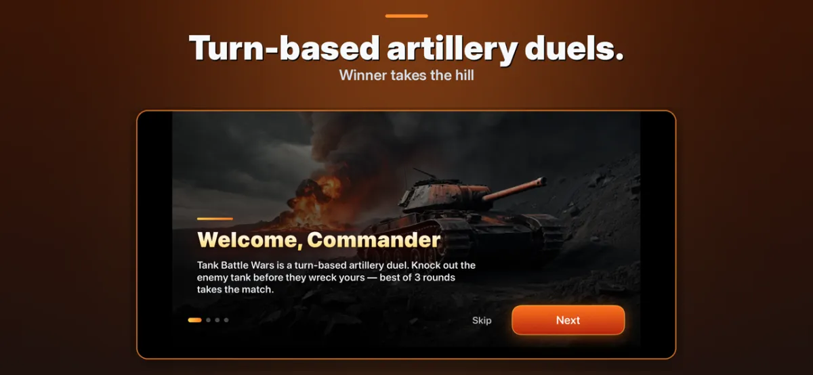
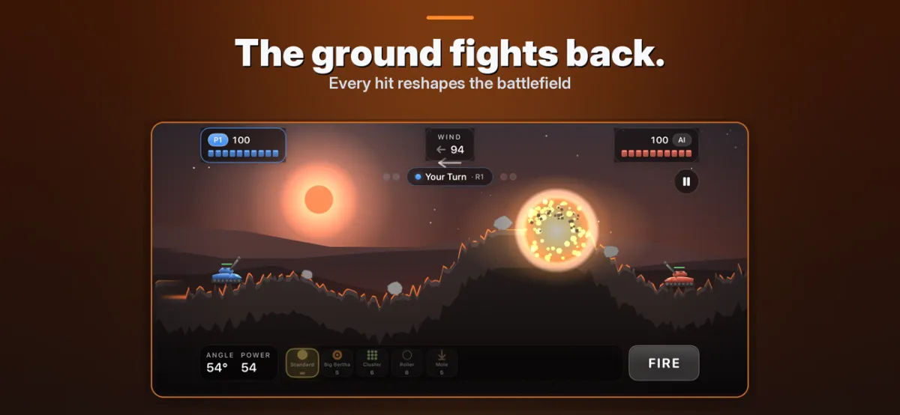

# Tank Battle Wars

Turn-based tank artillery duels with destructible terrain on iOS.

Tank Battle Wars is a side-view turn-based artillery game where you set your firing angle and power, read the wind, and blast craters into the terrain until one tank remains. Play solo against the computer or pass your iPhone or iPad to a friend for a two-player local duel. Free to download (3 battles per day). Optional one-time Full Unlock for $2.99, plus optional coin packs ($0.99 to $4.99).

- Website: https://workmanl.github.io/Tank-Battle-Wars/
- App Store: https://apps.apple.com/us/app/tank-battle-wars/id6806902295
- Support: https://github.com/workmanl/Tank-Battle-Wars/issues
- Email: hello@emrldlabs.com
- Privacy: https://workmanl.github.io/Tank-Battle-Wars/privacy.html

## About this repository

The app's source code is not public. This repository is used for support: please open an issue for bug reports and questions.
